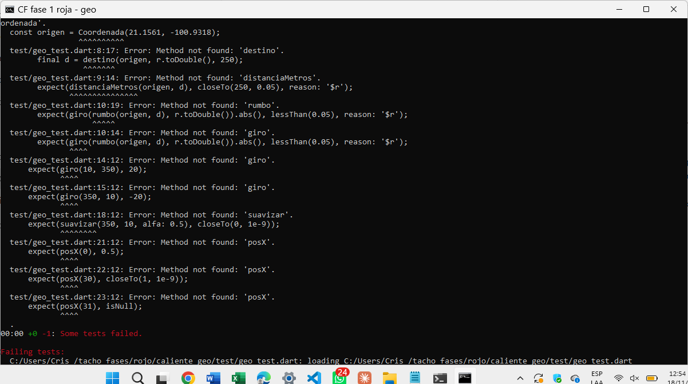
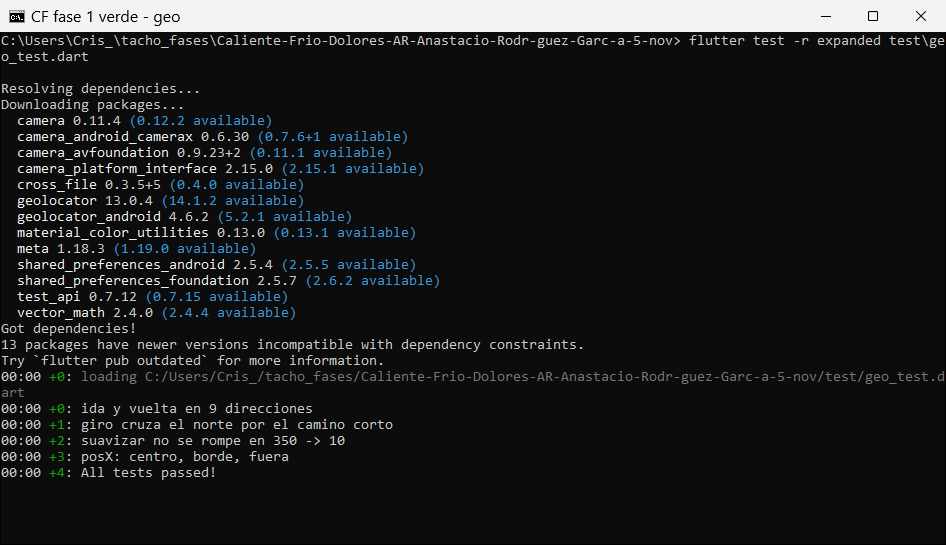
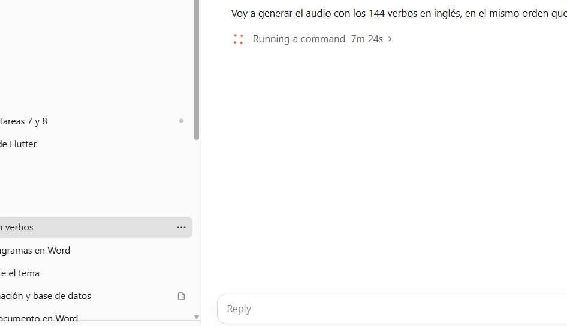
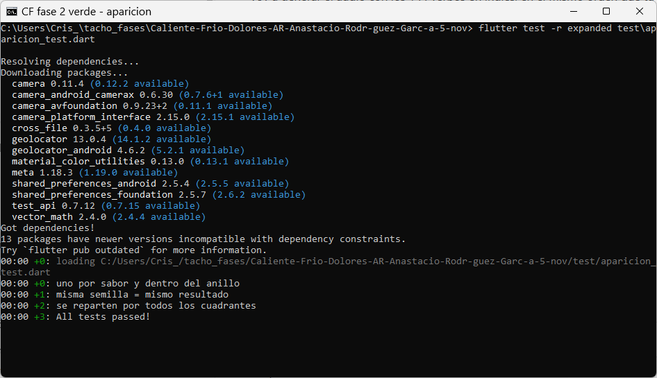
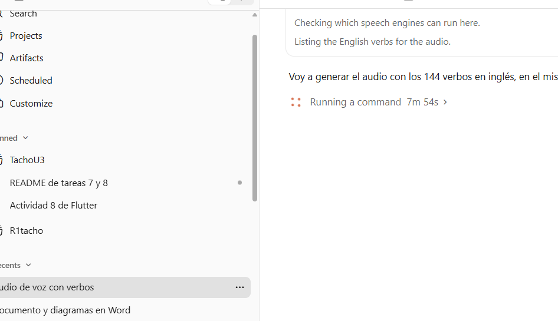
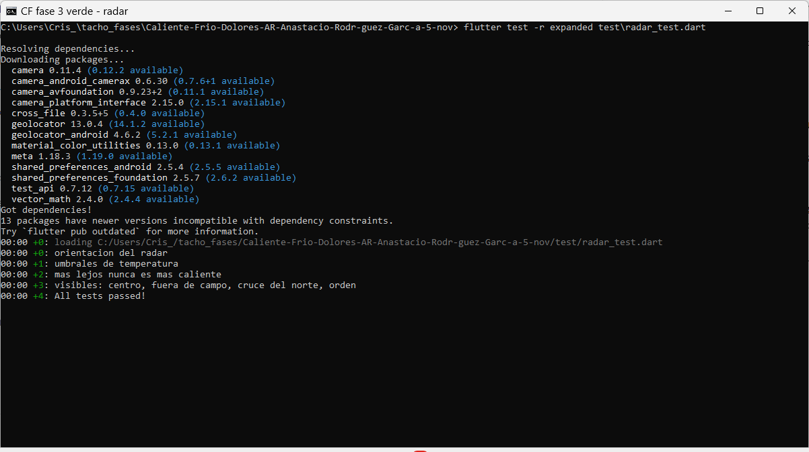
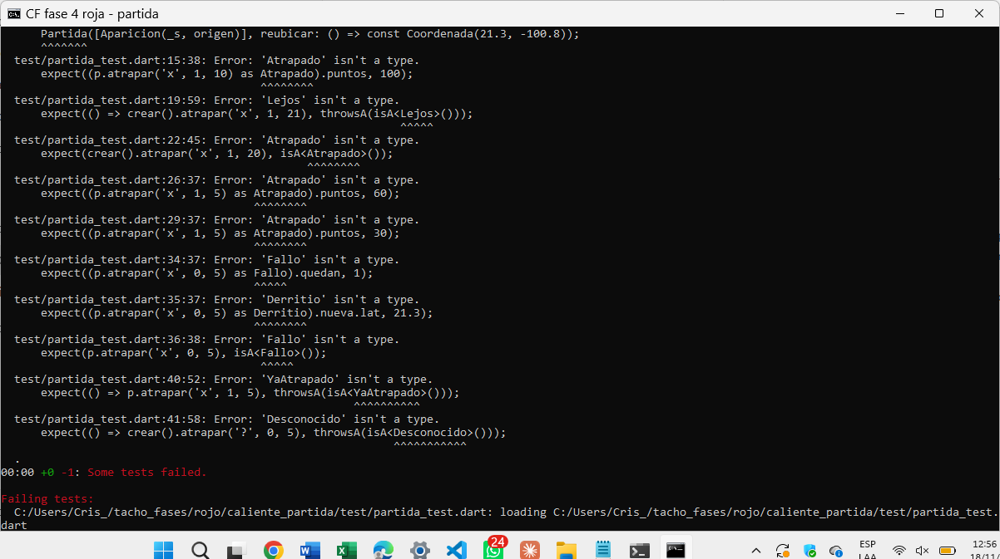
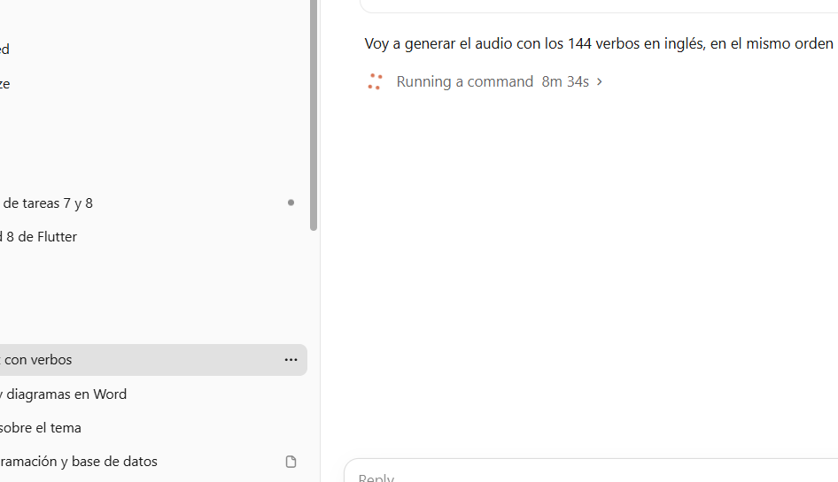

## Fase 1. Cálculos de ubicación

Esta fase calcula distancias, rumbos y giros entre coordenadas alrededor del Jardín Principal de Dolores Hidalgo, que es la base del juego de caliente y frío.

Pruebas (`test/geo_test.dart`):

1. Ida y vuelta en 9 direcciones.
2. El giro cruza el norte por el camino corto.
3. Suavizar no se rompe de 350° a 10°.
4. Posición en pantalla: centro, borde y fuera.

### Fase roja

La prueba falla porque todavía falta implementar las funciones de distancia, rumbo y giro.

### Fase verde

Se agregan las funciones `destino`, `distanciaMetros`, `rumbo`, `giro`, `suavizar` y `posX`.

## Fase 2. Esconder las nieves

Esta fase esconde los 6 sabores de nieve entre 60 y 400 metros del punto de inicio, repartidos en todas las direcciones.

Pruebas (`test/aparicion_test.dart`):

1. Uno por sabor y dentro del anillo.
2. Misma semilla, mismo resultado.
3. Se reparten por todos los cuadrantes.

### Fase roja

La prueba muestra el error antes de completar la función que esconde los sabores.

### Fase verde

Se agrega la lista de sabores y las funciones `esconder` y `puntoEnAnillo`.

## Fase 3. Radar caliente y frío

Esta fase dibuja el radar y dice qué tan cerca está la nieve: ardiente, caliente, tibio, frío o helado.

Pruebas (`test/radar_test.dart`):

1. Orientación del radar.
2. Umbrales de temperatura.
3. Más lejos nunca es más caliente.
4. Visibles: centro, fuera de campo, cruce del norte y orden.

### Fase roja

La prueba falla mientras todavía no existe el código del radar ni la temperatura por distancia.

### Fase verde

Se agregan `puntoRadar`, `temperatura` y `visibles` para mostrar las nieves en la cámara.

## Fase 4. Reglas de la partida

Esta fase controla la captura: solo se puede atrapar a 20 metros o menos, hay 3 intentos (100, 60 y 30 puntos) y al tercer fallo la nieve se derrite y reaparece en otro lugar.

Pruebas (`test/partida_test.dart`):

1. Acierto al primer intento: 100 puntos.
2. Lejos: no se puede intentar.
3. A exactamente 20 m cuenta.
4. Segundo intento 60, tercero 30.
5. Tres fallos: se derrite y reaparece; el contador se reinicia.
6. No se atrapa dos veces ni existe uno desconocido.
7. Restaurar ignora ids raros.

### Fase roja

La prueba muestra el error antes de completar las reglas de la partida.

### Fase verde

Se agrega la clase `Partida` con los intentos, los puntos, el derretido y el guardado del progreso (solo ids y puntaje, nunca coordenadas).

## Aplicación completa

La aplicación usa la cámara, el GPS y la brújula para buscar las nieves con realidad aumentada. También tiene un modo demo para jugar sin salir del salón.

## Resultado

Las cuatro fases quedaron documentadas una por una, con su evidencia roja, su evidencia verde y la captura final de la aplicación. En total son 18 pruebas y todas pasan.
# Caza de Nieves AR (Dolores Hidalgo)
Version original del "Rally AR": atrapas 6 sabores de nieve escondidos alrededor del Jardin Principal.
Reglas: aparecen a 60-400 m, captura a <=20 m, 3 intentos (100/60/30 pts), al 3er fallo la nieve
se derrite y reaparece. Progreso guardado: solo ids y puntaje (nunca coordenadas).

## Pasos
1. `flutter create .`  (genera android/ e ios/; no pisa lib/ ni test/)
2. `flutter pub get && flutter test`
3. Android (AndroidManifest.xml): permisos CAMERA, ACCESS_FINE_LOCATION, ACCESS_COARSE_LOCATION; minSdk 21.
4. iOS (Info.plist): NSCameraUsageDescription y NSLocationWhenInUseUsageDescription.
5. `flutter run` -> "Modo demo" para jugar sin salir del salon.

Verifica las preguntas con heladeros/cronistas locales antes de usarlas en clase.
